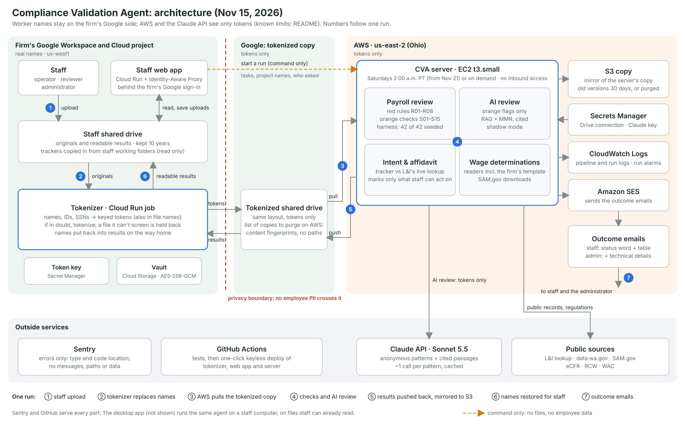

# Compliance Validation Agent (CVA): capstone copy

An agent that checks prevailing-wage compliance on publicly funded construction projects, built for a small
compliance consulting firm in Washington State and submitted as the capstone project of the Carnegie Mellon
University / Emeritus *Agentic AI Program* (Fall 2026), by David Figueiras-Garcia.

This repository is a **curated public copy** of the CVA's code. The working repository is private: it holds the
firm's deployment and operating history. Here every firm-specific name, domain and identifier has been replaced, the
firm's logo swapped for a neutral one, and the deployment scripts left out. **All data in this repository is
invented.**

**To see it run:** [DEMO.md](DEMO.md) (one command on a laptop, offline, invented data).

## The problem

On public works, contractors must pay each trade at least the prevailing wage (federal, state or union rates), and
every contractor must file a Statement of Intent before work and an Affidavit of Wages Paid at the end with
Washington's Department of Labor & Industries (L&I). The firm checks certified payrolls line by line and matches
filings against L&I's records by hand, on 20 projects. The CVA does the routine checking, so staff review only the
exceptions, and it keeps workers' personal data on the firm's side.

## What it does

Per project, weekly or on demand:

- **Payroll review:** each payroll line against the project's wage rates: 8 red rules (definitely broken, R01–R08:
  hours per day, overtime and double-time rates, union weekend rules, fringe and base rates) and 15 orange checks
  (needs a person, S01–S15: hours over 8, approximate classification match, arithmetic, duplicates, missing or
  unusable values...). The reviewed workbook comes back with marked cells, notes, a Comments sheet and a Review
  decisions sheet.
- **Intent/affidavit check:** the project's compliance tracker against L&I's public records: missing or wrong IDs,
  the wrong hiring contractor, affidavits L&I has that the tracker lacks; only what staff can act on is marked.
- **Wage updates:** new wage tables merged into the project's rates.
- **AI review** of the judgment-type orange flags: retrieval over regulations, staff documents and past staff
  decisions, ranked with maximal marginal relevance (MMR); Claude suggests "keep the flag" or "likely fine" with
  citations. It runs in shadow mode in production (measured, not shown); rules flag, the model suggests, staff decide.

## Architecture



Readable data stays in the firm's Google account. A **tokenizer** replaces workers' names, IDs and anything the
agent doesn't read with keyed, reversible tokens before files go to the **agent** on AWS; results come back through
the tokenizer, which restores the names. [docs/dataflow.png](docs/dataflow.png) shows the logical data flow with the
guardrails, run log and evaluation added in Module 6.

## Repository layout

| Path | What it is |
|---|---|
| `code/compliance_agent/agent/` | The agent: `runner.py` (runs tasks), `payroll.py` (the rules), `intent.py` (tracker vs L&I), `lni_live.py` (L&I's lookup), `wages.py` (wage files), `ai_review.py` + `compliance_rag.py` + `knowledge.py` (AI review: retrieval, MMR, Claude), `upload_checks.py`, `events.py` (structured run log), `notify.py` / `staff_email.py` (emails) |
| `code/compliance_agent/ui/` | The web UI (`server.py`, `static/index.html`): add files, run tasks, results |
| `code/compliance_agent/tools/` | The evaluation harness (`run_evals.py`, `eval_cases.py`, `eval_lni.py`), the snapshot and comparison tools, the upgrade test |
| `code/compliance_agent/tests/` | A selection of the agent's tests (the seeded-violation acceptance test, the harness's own tests, upload checks, AI review, layout) |
| `code/tokenizer/` | The tokenizer (`pii_tokenizer/`): tokens, doubt mode, fail-closed tables, file-name tokens, PDF screening; its settings and tests |
| `code/filekinds/` | The shared file-kind registry: how each kind of file is recognized and which of its columns may cross to AWS |
| `code/rag_ranking/` | The retrieval and ranking demo and tests |
| `demo/` | The demo: `make_demo_data.py` (seeded generator + answer key), `run_demo.py` / `run_demo.sh` (launcher), `lni_standin.py` (invented L&I records), `show_tokenized.py` (the AWS view), `check_demo.py` (end-to-end score) |

## Setup and usage

Python 3.12 or newer:

```bash
python3 -m venv .venv && source .venv/bin/activate
pip install -r code/compliance_agent/requirements.txt -r code/tokenizer/requirements.txt pytest
bash demo/run_demo.sh                       # the demo: see DEMO.md
```

## Evaluation

```bash
cd code/compliance_agent
python tools/run_evals.py                   # the whole pipeline on invented projects, scored against an answer key
python -m pytest -q tests                   # agent tests (also: cd ../tokenizer && python -m pytest -q tests)
python ../../demo/check_demo.py             # the demo end to end through the UI's API, scored against its key
```

The harness runs the tokenizer then the agent, offline, on invented projects, and scores each line: seeded errors
detected, false flags on clean lines, file outcomes and skip reasons, tracker findings, network requests (a local
stand-in for L&I is the only route) and a privacy search of every output. Results on Nov 15–16, 2026: 42 of 42
seeded payroll errors, 45 of 45 clean lines with no flag (0 false flags among 62), 13 of 14 files with the expected
outcome (one known gap: a header below row 7), 19 of 19 tracker findings, 0 invented worker names or IDs in any
output. These numbers mean "no regression on a small set written from the rules", not real-world accuracy.

## Not in this copy

Comments and docstrings mention issue numbers (#53, #121...) and documents (`docs/evals.md`, `installation.md`,
`HANDOFF`, `deploy/...`) of the private repository: they are not in this copy and leak nothing; the text around
each says what it was about. The evaluation harness's invented workers have IDs 7319nnn; the demo's, 7320nnn.


The firm's deployment (AWS, Google Cloud, GitHub Actions), its operating documents and history, most of its tests
(they use the firm's real project names), the desktop-app build, and the change history shown in the emails. The
reference rules workbook and any real payroll, tracker or staff file were never in any repository.
